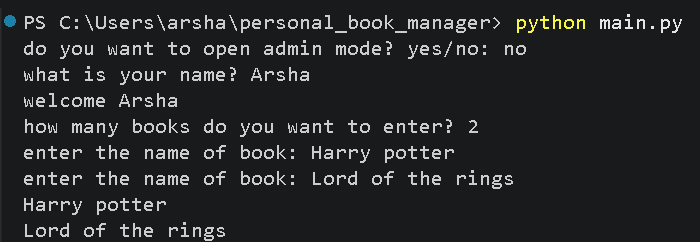
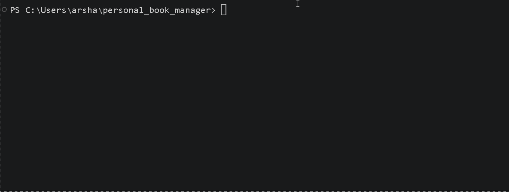

# Personal Book Manager


A simple book manager built with python

## Features
- Add multiple books
- Save books
- Display books
- Load Books
- Admin mode

## Requirements
- Python
- python-dotenv

## Instalation
Install the required packages
```bash
python -m pip install requirments.txt
```
## Environment setup
create a `.env` file in the project folder

Use `.env.example` as a template

Add your admin password

```env
BOOK_MANAGER_ADMIN_PASSWORD=your_password_here
```
Replace `your_password_here` with your own admin password

## Run The Program
Run the main file:
```bash
python main.py
```
## Screenshot


## Demo
